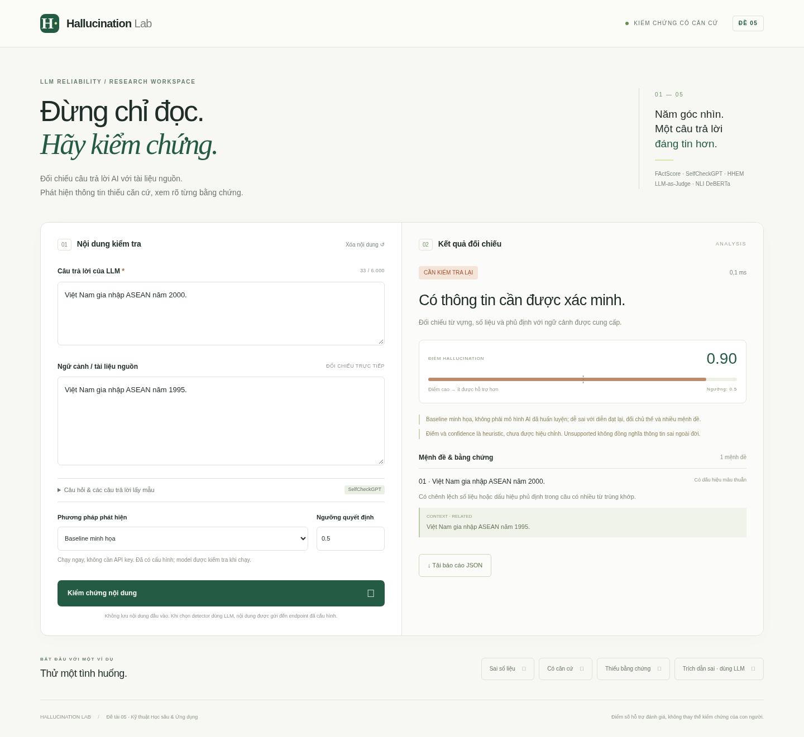

# Đề 05 — Phát hiện hallucination trong đầu ra LLM

Bài làm gồm API FastAPI, giao diện tiếng Việt, năm detector có thể cấu hình, baseline chạy offline, chuẩn hóa dữ liệu, calibration và công cụ đánh giá. Các tệp quản lý sinh viên ở thư mục cha được giữ nguyên.

**Xem bài:** [Báo cáo đề tài](docs/BAO_CAO.md) · [Dàn ý thuyết trình](docs/THUYET_TRINH.md) · [Kết quả thực nghiệm](docs/results/halueval-qa-baseline.json)



**Phạm vi đã chạy:** demo/baseline, kiểm thử API, pipeline dữ liệu và đánh giá HaluEval QA. **Chưa xác nhận chất lượng của năm detector nghiên cứu** khi chưa có endpoint Qwen và checkpoint HHEM/NLI. Không dùng baseline để giả lập điểm của các model.

## 1. Chạy nhanh

Yêu cầu Python 3.11 trở lên; không cần Node, GPU, database hoặc API key cho demo.

```bash
cd /workspace/StudentManagement_102173/de05_hallucination
python3 -m venv .venv
.venv/bin/python -m pip install -r requirements.lock -e .
.venv/bin/uvicorn hallucination_lab.app:app --host 127.0.0.1 --port 8000
```

Mở giao diện bằng trình duyệt có quyền truy cập máy chạy server, cổng 8000. API docs ở đường dẫn `/docs`; `/health` kiểm tra server, `/methods` cho biết cấu hình detector. Không cần chạy build frontend. Dừng server bằng `Ctrl+C`.

Trong giao diện: chọn ví dụ → chỉnh câu trả lời và nguồn → chọn phương pháp → kiểm chứng → xem mệnh đề/bằng chứng → tải JSON. Nội dung không được lưu tại API; detector dùng LLM sẽ gửi nội dung tới endpoint người vận hành cấu hình.

## 2. Năm phương pháp theo đề

| ID | Cách thực hiện | Thành phần cần có |
|---|---|---|
| `factscore` | LLM tách atomic facts, truy hồi top-5 câu nguồn, judge kiểm chứng; score = 1 − tỷ lệ facts được hỗ trợ | Endpoint LLM |
| `selfcheckgpt` | SelfCheckGPT-Prompt: chấm nhất quán với ≥2 mẫu độc lập; có thể sinh 3 mẫu từ câu hỏi | Endpoint LLM; mẫu từ cùng generator |
| `hhem` | HHEM v1 CrossEncoder; score = 1 − factual consistency | Extra `models`, checkpoint |
| `llm_judge` | Qwen2.5-7B-Instruct qua API tương thích OpenAI; JSON schema, đối chiếu quote | Endpoint LLM |
| `nli` | DeBERTa-v3-small NLI; score = 1 − P(entailment) | Extra `models`, checkpoint |

`ensemble` yêu cầu đủ 5 detector; lấy trung bình đều, không âm thầm bỏ detector lỗi. `evidence_baseline` là phương pháp thứ sáu dùng từ vựng/số liệu/phủ định, chỉ để chạy demo và làm mốc so sánh. Baseline không hiểu đầy đủ ngữ nghĩa.

FActScore là **bản triển khai theo ý tưởng** trên tài liệu cung cấp, không tái tạo toàn bộ Wikipedia retrieval của thư viện gốc. SelfCheckGPT sử dụng biến thể prompting trong repo chính thức, không phải biến thể BERTScore. HHEM dùng bản v1 mở, không phải model thương mại trên leaderboard. NLI/HHEM mặc định chủ yếu dành cho tiếng Anh; demo tiếng Việt không chứng minh năng lực đa ngôn ngữ của các checkpoint này.

### Bật LLM judge, FActScore và SelfCheckGPT

Ứng dụng gọi `/chat/completions`, hỗ trợ `response_format={"type":"json_object"}`. Ví dụ khi đã có Qwen chạy qua vLLM trên máy có GPU:

```bash
# Chạy riêng trên máy có vLLM và đủ VRAM; không nằm trong cài đặt demo.
vllm serve Qwen/Qwen2.5-7B-Instruct --port 8001 --max-model-len 8192

# Trong shell khởi động Hallucination Lab:
export JUDGE_BASE_URL=http://127.0.0.1:8001/v1
export JUDGE_MODEL=Qwen/Qwen2.5-7B-Instruct
# Nếu provider yêu cầu khóa: đặt JUDGE_API_KEY qua cơ chế secret của môi trường.
.venv/bin/uvicorn hallucination_lab.app:app --host 127.0.0.1 --port 8000
```

Endpoint từ xa phải dùng HTTPS. `.env.example` chỉ mô tả biến, ứng dụng không tự đọc `.env`. Không điền khóa vào mã nguồn, báo cáo hay Git. Các biến được đọc ở tiến trình server; thiết lập ở shell khác không thay đổi server đang chạy.

SelfCheckGPT cần các mẫu thực sự độc lập từ **cùng model sinh câu trả lời gốc**, cùng câu hỏi. Nếu dùng chức năng sinh mẫu tự động, câu trả lời gốc cũng cần đến từ `JUDGE_MODEL`; ứng dụng không thể tự xác minh nguồn gốc đầu vào.

### Bật HHEM và NLI

```bash
.venv/bin/python -m pip install -e '.[models]'
export ENABLE_LOCAL_MODELS=1
export MODEL_DEVICE=cpu  # hoặc cuda khi có PyTorch/CUDA phù hợp
export NLI_MODEL=cross-encoder/nli-deberta-v3-small
export HHEM_MODEL=vectara/hallucination_evaluation_model
export HHEM_REVISION=hhem-1.0-open
```

Khởi động lại server. Lần đầu cần tải weights; những lần sau dùng Hugging Face cache. Có thể đặt `NLI_REVISION`, `HHEM_REVISION` thành commit bất biến để tái lập. Không bật `trust_remote_code`; HHEM v2 không được thay vào adapter v1 này. Checkpoint NLI thay thế phải có `id2label` gồm `entailment`, `neutral`, `contradiction`.

Trong môi trường cloud hiện tại, truy cập `huggingface.co` đã trả **403 từ proxy**. Cần cho phép các host Hugging Face và host CDN thực tế của checkpoint trong cài đặt mạng trước khi tải model. Không tắt TLS hay bỏ qua proxy để khắc phục. Thư viện `models` và suy luận model thật chưa được xác minh trong phiên này.

## 3. API

```bash
curl --fail-with-body -X POST http://127.0.0.1:8000/detect \
  -H 'Content-Type: application/json' \
  -d '{"claim":"Việt Nam gia nhập ASEAN năm 2000.","context":"Việt Nam gia nhập ASEAN năm 1995.","method":"evidence_baseline","threshold":0.5}'
```

Trường trả về: `is_hallucination`, `score`, `confidence`, `confidence_kind`, `evidence`, `findings`, `warnings`, `latency_ms`; ensemble thêm `components`. `score` cao nghĩa là ít được nguồn hỗ trợ hơn. `confidence` là điểm theo nhãn dự đoán, **không phải xác suất chính xác đã hiệu chỉnh**. `is_hallucination=null` là chưa đủ dữ liệu, không được đổi thành `false`. `unsupported` khác `contradicted`: không tìm thấy bằng chứng không chứng minh câu đó sai ngoài đời.

Ngưỡng là tham số quyết định; kết quả dưới ngưỡng không khẳng định chân lý. Mỗi finding có loại lỗi `factual_error`, `unfaithful_summary`, `fabricated_citation`, `unsupported`, hoặc `none`. Phân loại chuyên biệt dựa trên LLM judge; baseline/NLI không được gán là đã nhận diện đầy đủ mọi loại lỗi. Chỉ gán `fabricated_citation` khi nguồn đủ để bác bỏ trích dẫn; không xác thực DOI/web tự động.

Thiếu cấu hình → HTTP 503; model lỗi/JSON hoặc quote sai → HTTP 502; input sai → HTTP 422. Không chuyển lỗi thành kết quả sạch. Giới hạn 6.000 ký tự claim, 40.000 ký tự context, 30 câu và 10 samples.

## 4. Dữ liệu và đánh giá

### HaluEval

```bash
.venv/bin/python scripts/download_data.py halueval-qa truthfulqa
.venv/bin/hallucination-lab prepare --dataset halueval --task qa \
  --input data/downloads/halueval-qa.json --output data/processed/halueval-qa.jsonl
.venv/bin/hallucination-lab evaluate --data data/processed/halueval-qa.jsonl \
  --split test --methods evidence_baseline --output artifacts/halueval-test
```

Downloader hỗ trợ thêm `halueval-dialogue`, `halueval-summarization`, `halueval-general`; adapter hỗ trợ `--task dialogue|summarization|general`. HaluEval gốc có 35K bản ghi: 10K QA, 10K dialogue, 10K summarization, 5K general. Với task có cặp đúng/sai, mỗi bản ghi tạo **hai candidate**, không gọi 20K candidate QA là 20K nguồn. General không có context nên detector grounded sẽ abstain nếu không bổ sung bằng chứng.

Download dùng TLS và lưu URL, revision, SHA-256 trong `.source.json`. Mặc định revision `main` có thể thay đổi; dùng `--revision <commit>` để cố định. Checksum ghi nhận tệp tải về, không thay thế chữ ký nhà xuất bản. Script không ghi đè bản tải cũ.

Split theo hash `seed=42` của **source group**, tỷ lệ mục tiêu 70/15/15; mọi candidate của cùng nguồn giữ cùng split. Không tinh chỉnh prompt/threshold trên test. Kết quả là thiết lập detection của bài làm, không đồng nhất hoàn toàn với giao thức sampling của tác giả.

### TruthfulQA

```bash
.venv/bin/hallucination-lab prepare --dataset truthfulqa \
  --input data/downloads/truthfulqa.csv --contexts data/independent-contexts.json \
  --output data/processed/truthfulqa-with-context.jsonl
```

`independent-contexts.json` là map `{ "nguyên văn câu hỏi": "đoạn bằng chứng độc lập" }`, do người thực hiện thu thập và kiểm chứng. Có thể bỏ `--contexts` để kiểm tra định dạng; khi đó context rỗng và grounded detector không thể đánh giá. **Không lấy Best Answer làm bằng chứng**, tránh rò rỉ đáp án. Adapter tạo cặp Best Answer/Best Incorrect Answer cho bài toán phát hiện, không gọi đây là điểm generation hoặc MC chính thức của TruthfulQA. Bản CSV tải trong phiên có 790 câu hỏi, khác con số 817 của phiên bản gốc.

### HallusionBench

Tên trong đề cần phân biệt với Vectara Hallucination Leaderboard. [HallusionBench chính thức](https://github.com/tianyi-lab/HallusionBench) là benchmark **ảnh–văn bản**, cần ảnh và VLM, không thể đánh giá đúng bằng API text-only này. Chưa triển khai/chưa chạy benchmark đa phương thức; không biến nhãn hoặc caption tham chiếu thành context rồi gọi đó là kết quả HallusionBench. Xem hướng mở rộng trong báo cáo.

### So sánh năm phương pháp

Khi model và endpoint đã sẵn sàng, bổ sung samples/câu hỏi cho SelfCheckGPT rồi chạy:

```bash
.venv/bin/hallucination-lab evaluate --data data/processed/halueval-qa.jsonl \
  --split test --limit 100 \
  --methods factscore selfcheckgpt hhem llm_judge nli \
  --output artifacts/compare-five
```

Chạy đủ split bằng cách bỏ `--limit`. Dữ liệu summarization không có câu hỏi; cần cung cấp prompt sinh gốc và samples cho SelfCheckGPT, không tự dùng claim làm câu hỏi. Chọn thư mục output mới cho mỗi lần chạy. Đầu ra `predictions.jsonl`, `summary.json` chứa source SHA, tham số, lỗi, độ phủ và Precision/Recall/F1/AUC-ROC/Kappa. Exit code **2** khi có lỗi hoặc abstention; kết quả từng mẫu vẫn được lưu. AUC/Kappa không xác định trả `null`, không phải 0.

### Calibration và human evaluation

```bash
.venv/bin/hallucination-lab evaluate --data data/demo.jsonl --split validation \
  --methods evidence_baseline --output artifacts/validation-demo
.venv/bin/hallucination-lab calibrate --predictions artifacts/validation-demo/predictions.jsonl \
  --method evidence_baseline --output artifacts/calibration-demo.json --target 0.8
.venv/bin/hallucination-lab evaluate --data data/demo.jsonl --split test \
  --methods evidence_baseline --calibration artifacts/calibration-demo.json --output artifacts/test-demo
```

Platt scaling và chọn threshold chỉ trên validation; test kiểm tra group không trùng dữ liệu calibration. Demo chỉ có 24 candidate tự soạn, dùng kiểm tra pipeline, không đủ để kết luận khoa học hoặc hiệu chỉnh xác suất đáng tin cậy. Với thực nghiệm chính dùng tập validation đủ lớn, riêng cho từng method/checkpoint/prompt; nên tách thêm tập calibration và threshold-selection nếu đủ dữ liệu.

Human agreement dùng JSONL `{"id":"sample-1","annotator_a":0,"annotator_b":1}`; hai người gán nhãn độc lập trước thảo luận:

```bash
.venv/bin/hallucination-lab agreement --annotations data/human-annotations.jsonl
```

Kappa trong benchmark là **model–gold**; Kappa từ lệnh `agreement` mới là **human–human**. Chưa có nhãn từ người đánh giá thật trong phiên này. Đích Precision/Recall ≥0,80 là mục tiêu nghiên cứu, không bảo đảm trên mọi dataset.

## 5. Kiểm thử và cấu trúc

```bash
.venv/bin/pytest -q
.venv/bin/ruff check .
# Tùy chọn: khi Playwright và Chromium đã được cài, server đang chạy:
node scripts/browser_smoke.cjs
```

Test model dùng mock có chủ đích để kiểm tra logic, schema, chiều score và quote; không chứng minh accuracy của model thật. Trong sandbox chặn socket, TestClient có thể bị treo; cần quyền chạy test với kết nối nội bộ.

```text
hallucination_lab/
  app.py              FastAPI và static UI
  detectors.py        5 detector, baseline, ensemble
  llm.py              LLM client, prompts, kiểm tra JSON và quote
  models.py           Adapter HHEM/NLI, lazy loading, batch inference
  schemas.py          Input/output contract
  datasets.py         Chuẩn hóa và chia tập theo source group
  evaluation.py       Metrics, calibration, human agreement
  cli.py              CLI thí nghiệm
  static/             HTML/CSS/JS thuần; không tải tài nguyên ngoài
data/demo.jsonl       24 candidate tự soạn
scripts/              Download và kiểm tra trình duyệt
tests/                Kiểm thử chức năng
docs/BAO_CAO.md       Báo cáo và giới hạn thực nghiệm
docs/THUYET_TRINH.md  Dàn ý bảo vệ + kịch bản demo
```

Không dùng kết quả chẩn đoán này cho quyết định quan trọng mà thiếu người kiểm chứng. API mặc định chỉ bind loopback; triển khai chia sẻ cần bổ sung xác thực, giới hạn tài nguyên và cấu hình truy cập phù hợp.

## 6. Tài liệu gốc

- [FActScore](https://github.com/shmsw25/FActScore), Min et al., 2023, [arXiv:2305.14251](https://arxiv.org/abs/2305.14251).
- [SelfCheckGPT](https://github.com/potsawee/selfcheckgpt), Manakul et al., 2023, [arXiv:2303.08896](https://arxiv.org/abs/2303.08896).
- [HaluEval](https://github.com/RUCAIBox/HaluEval), Li et al., 2023, [arXiv:2305.11747](https://arxiv.org/abs/2305.11747).
- [Vectara Hallucination Leaderboard](https://github.com/vectara/hallucination-leaderboard), [HHEM model](https://huggingface.co/vectara/hallucination_evaluation_model).
- [TruthfulQA](https://github.com/sylinrl/TruthfulQA), Lin et al., 2022, [arXiv:2109.07958](https://arxiv.org/abs/2109.07958).
- [HallusionBench](https://github.com/tianyi-lab/HallusionBench), Guan et al., CVPR 2024, [arXiv:2310.14566](https://arxiv.org/abs/2310.14566).

Mã trong thư mục này là triển khai mới; không sao chép mã nguồn các repo tham khảo. Khi phân phối dữ liệu/checkpoint phải tuân thủ giấy phép của từng nguồn.
