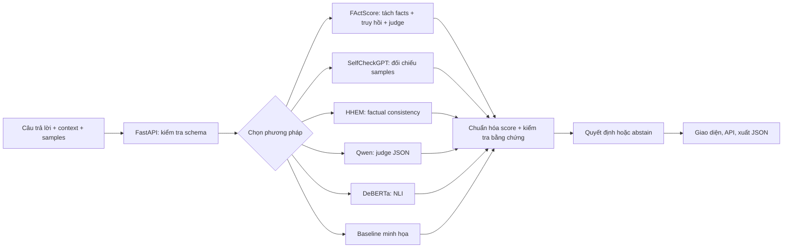

# Báo cáo đề tài 05

**Xây dựng hệ thống phát hiện hallucination trong đầu ra mô hình ngôn ngữ lớn**

Hướng tiếp cận: LLM-as-Judge, FActScore, SelfCheckGPT, HHEM và NLI.

Mã sinh viên gắn với repository: **102173**. Tác giả/lớp/giảng viên: người nộp bổ sung.

Ngày thực nghiệm: 05/11/2026.

## 1. Tóm tắt

Đầu ra LLM có thể trôi chảy nhưng chứa thông tin sai hoặc không được nguồn hỗ trợ. Đề tài xây dựng hệ thống nhận một câu trả lời và ngữ cảnh, phân tích từng mệnh đề, trả về mức cảnh báo cùng bằng chứng. Giao diện web tiếng Việt sử dụng FastAPI; phần thực nghiệm cung cấp bộ chuyển đổi HaluEval/TruthfulQA, chia tập theo nguồn, chỉ số phân loại, calibration và đo sự đồng thuận người gán nhãn.

Phiên bản hiện tại đã chạy baseline đối chiếu từ vựng trên 2.980 candidate thuộc test split HaluEval QA: Precision **0,9185**, Recall **0,9154**, F1 **0,9170**, AUC-ROC **0,9115**. Đây là kết quả của một baseline với nguồn gốc được cung cấp, không chứng minh chất lượng của các detector dựa trên model, khả năng kiểm chứng thế giới mở hoặc hiệu quả trên toàn bộ HaluEval 35K.

Năm detector nghiên cứu đã có adapter và kiểm thử logic bằng mock; suy luận checkpoint thật và bảng so sánh năm phương pháp **chưa được chạy** vì thiếu endpoint LLM và quyền tải model. Báo cáo giữ riêng kết quả đo được và phần thực nghiệm còn lại.

## 2. Bài toán và mục tiêu

Đầu vào gồm claim/câu trả lời `y`, context `c`, câu hỏi gốc `q` và các câu trả lời lấy mẫu `S` nếu dùng SelfCheckGPT. Đầu ra gồm:

- `score ∈ [0,1]`: điểm thiếu hỗ trợ hoặc bất nhất theo phương pháp;
- `is_hallucination ∈ {true, false, null}`: quyết định theo ngưỡng hoặc từ chối kết luận;
- các mệnh đề, phân loại lỗi, giải thích ngắn, trích đoạn bằng chứng;
- method, độ trễ và cảnh báo giới hạn.

Các loại lỗi cần khảo sát:

| Loại | Ví dụ | Điều kiện để nhận diện |
|---|---|---|
| Factual error | Ghi gia nhập ASEAN năm 2000 trong khi nguồn ghi 1995 | Nguồn có thông tin đối chiếu đủ rõ |
| Unfaithful summary | Tóm tắt đảo kết luận hoặc thêm kết quả không có trong tài liệu | Có văn bản gốc và xét đầy đủ mệnh đề |
| Fabricated citation | Quy kết kết quả 99% cho báo cáo chỉ ghi 71% | Có nội dung báo cáo/tham chiếu đủ để kiểm chứng |
| Unsupported | Đưa con số cỡ mẫu nhưng nguồn không nêu | Chỉ kết luận thiếu hỗ trợ, không tự khẳng định sai ngoài đời |

Mục tiêu Precision và Recall ≥0,80 là đích thực nghiệm trong một giao thức xác định. Không được dùng chất lượng demo hoặc một dataset để khẳng định đạt mục tiêu tổng quát. Các nhãn lỗi chuyên biệt do judge đề xuất chưa có gold labels theo loại để tính macro-F1 loại lỗi.

## 3. Cơ sở và nghiên cứu liên quan

**FActScore — Min et al. (2023).** Đánh giá factual precision của văn bản dài bằng cách tách các atomic facts và xác minh trên kho tri thức. Thiết kế này giúp chỉ ra mệnh đề cụ thể gây lỗi thay vì gán một nhãn cho cả đoạn. Bài làm giữ ý tưởng atomic facts nhưng dùng context người dùng, không tuyên bố tái lập Wikipedia retrieval/benchmark của tác giả.

**SelfCheckGPT — Manakul et al. (2023).** So sánh câu trả lời với các câu trả lời lấy mẫu độc lập từ cùng model. Các chi tiết ít đáng tin có thể thay đổi giữa các lần sinh. Bài làm dùng biến thể LLM-Prompting công bố trong repo. Nhất quán không đủ chứng minh sự thật vì model có thể lặp lại cùng ngộ nhận.

**HaluEval — Li et al. (2023).** Benchmark 35K ví dụ bao gồm QA, dialogue, summarization và general queries. Các task có nguồn và cặp đáp án đúng/sai phù hợp kiểm tra factual consistency. Dữ liệu sinh tự động có thể chứa dấu hiệu bề mặt; cần phân tích khả năng baseline khai thác khác biệt từ vựng.

**HHEM và NLI.** HHEM học đánh giá tính nhất quán giữa tài liệu và đầu ra. NLI phân loại quan hệ premise–hypothesis thành entailment/neutral/contradiction. Việc không entail không tự động đồng nghĩa thông tin sai; neutral có thể phản ánh nguồn thiếu thông tin.

**LLM-as-Judge.** Judge mạnh có thể hiểu diễn đạt lại, mệnh đề phức và yêu cầu phân loại lỗi. Tuy nhiên, chi phí, tính bất định, thiên lệch và prompt injection cần được xét. JSON schema và quote validation giảm lỗi đầu ra nhưng không bảo đảm judge suy luận đúng.

## 4. Kiến trúc



Phần đánh giá tách khỏi API để chạy batch, lưu predictions và cấu hình. Model được tải theo nhu cầu và cache; suy luận local được giới hạn batch 8. Mặc định server không lưu claim/context. Báo cáo CLI có thể chứa trích đoạn nguồn nên cần quản lý như dữ liệu thí nghiệm.

### 4.1. FActScore-inspired

1. LLM phân rã tối đa 20 atomic facts; không thêm thông tin mới.
2. Mỗi fact truy hồi top-5 câu gần nhất theo từ vựng.
3. LLM kiểm chứng fact bằng context truy hồi; quote phải có trong nguồn gốc.
4. Trên facts có thể đánh giá, `score = 1 − số supported / số facts đã chấm`.
5. Có fact unknown thì không kết luận toàn bộ văn bản sạch nếu các fact khác chưa vượt ngưỡng.

Tách facts/truy hồi sai có thể làm mất bằng chứng. Bộ truy hồi hiện tại không phải semantic RAG; đây là hạn chế cần ablation riêng.

### 4.2. SelfCheckGPT-Prompt

Cho mỗi câu và mỗi sample, judge đánh giá tính nhất quán. Ánh xạ supported → 0; unsupported/contradicted → 1; unknown → 0,5; lấy trung bình qua samples. Điểm văn bản là điểm lớn nhất trong các câu. Nếu không có samples, có thể sinh ba câu trả lời từ câu hỏi với temperature 1.

Để đúng giả thiết phương pháp, samples và câu trả lời gốc phải do cùng generator sinh ra; đầu vào nhập tay không có cách xác minh điều này. Không được đưa gold context vào quá trình sinh samples rồi xem kết quả là zero-resource self-check.

### 4.3. HHEM v1 và DeBERTa NLI

Mỗi câu claim truy hồi top-4 câu nguồn, chấm từng cặp và chọn nguồn hỗ trợ tốt nhất. HHEM trả consistency nên đảo chiều bằng `1 − consistency`. NLI dùng `1 − P(entailment)` và giữ thông tin contradiction để giải thích. Điểm văn bản lấy giá trị lớn nhất để một lỗi rõ không bị nhiều câu đúng làm loãng.

Checkpoint tối đa 512 tokens; nguồn dài có thể bị cắt. HHEM v1 và DeBERTa mặc định thiên về tiếng Anh. Dùng model đa ngôn ngữ hoặc dữ liệu tiếng Việt là hướng nghiên cứu riêng, không mặc định suy rộng từ giao diện tiếng Việt.

### 4.4. Judge, bằng chứng và ensemble

Judge chỉ đánh giá theo context, trả JSON schema có verdict, score, explanation, error type và exact quotes. Mọi quote phải là substring thật của context; supported/contradicted thiếu quote bị từ chối. Context được đóng gói trong user JSON và system prompt yêu cầu không làm theo chỉ dẫn trong dữ liệu. Đây là biện pháp giảm rủi ro, không phải bằng chứng chống prompt injection tuyệt đối.

Ensemble yêu cầu cả năm phương pháp hoàn tất. Điểm trung bình đều chưa hiệu chỉnh; các thành phần có tương quan, vì vậy không coi trung bình là xác suất. Không loại bỏ detector lỗi để vẫn trả một kết quả có vẻ hoàn chỉnh.

## 5. Dữ liệu và giao thức

**HaluEval QA:** 10.000 source records, chuyển thành 20.000 candidate đúng/sai. Tất cả candidate của một source dùng chung group ID. Hash group với seed 42 tạo split mục tiêu 70/15/15; test thực tế gồm **1.490 source groups / 2.980 candidate**, cân bằng 1.490 nhãn đúng và 1.490 nhãn hallucination. Nhãn dương luôn là hallucination=1.

**TruthfulQA:** phiên bản gốc được mô tả có 817 câu hỏi; CSV tải ngày thực nghiệm có **790 câu hỏi**, chuyển thành 1.580 candidate. Adapter không lấy đáp án chuẩn làm bằng chứng. Chưa thu thập context độc lập nên chưa báo cáo điểm detection trên tập này. Cặp candidate detection cũng không tương đương thang điểm generation/MC chính thức.

**HallusionBench:** benchmark ảnh–văn bản của Guan et al., CVPR 2024. Để đánh giá hợp lệ cần ảnh gốc, câu hỏi và VLM; hệ thống text-only hiện tại chưa hỗ trợ. Vectara hallucination leaderboard là một tài nguyên khác, không thay thế HallusionBench. Nếu đề muốn một “HallucinationBench” văn bản khác, phải xác định URL và giao thức trước khi nhận là cùng bộ dữ liệu.

**Demo:** 24 candidate tự soạn từ 12 source groups, có ví dụ đổi số, phủ định, diễn đạt lại và đổi quan hệ chủ thể. Chia cố định 8 train / 8 validation / 8 test để kiểm tra pipeline. Không dùng demo làm benchmark học thuật.

Provenance và kết quả được lưu tại `docs/results/`. Predictions đầy đủ ở `artifacts/` của máy hiện tại; dữ liệu tải và artifacts lớn không đưa vào Git. SHA-256 tệp HaluEval QA gốc:

```text
89ed139ec5e3a3169a0b30e45569ac1283846f76f27f7bb5e908ee6deed57e88
```

## 6. Chỉ số và calibration

`Precision = TP/(TP+FP)`, `Recall = TP/(TP+FN)`, `F1 = 2PR/(P+R)`. AUC-ROC sử dụng score liên tục, không dùng nhãn threshold. Ma trận nhầm lẫn theo thứ tự hàng gold `[0,1]`, cột prediction `[0,1]`.

Metrics chỉ tính trên mẫu có kết luận hợp lệ; đồng thời phải công bố **coverage**, lỗi và abstention. Không được coi abstention là dự đoán đúng. Với một lớp gold duy nhất, AUC/Kappa không xác định trả `null`.

Calibration dùng logistic/Platt scaling trên validation rồi chọn threshold theo mục tiêu P/R ≥0,80 nếu có thể, nếu không chọn F1 tốt nhất. Tham số không được fit trên test; loader phát hiện group overlap giữa calibration và tập đánh giá. Điểm validation được dùng để fit chỉ mang tính chẩn đoán; test mới là đánh giá giữ lại. Với dữ liệu đủ lớn nên tách riêng calibration và threshold-selection.

Cohen’s Kappa `κ=(p_o−p_e)/(1−p_e)` có hai bối cảnh cần tách biệt: model–gold trong benchmark; human–human trong file hai người gán nhãn độc lập. Chưa thu thập nhãn người thật, vì vậy không báo cáo human agreement.

## 7. Kết quả đã đo

Lệnh chính, threshold 0,5 cố định, không calibration, không tinh chỉnh trên test:

```bash
.venv/bin/hallucination-lab evaluate \
  --data data/processed/halueval-qa.jsonl --split test \
  --methods evidence_baseline --output artifacts/halueval-qa-test-full
```

| Thiết lập | N | Coverage | Precision | Recall | F1 | AUC-ROC | Kappa model–gold |
|---|---:|---:|---:|---:|---:|---:|---:|
| Baseline từ vựng, HaluEval QA test | 2.980 | 100% | 0,9185 | 0,9154 | 0,9170 | 0,9115 | 0,8342 |
| FActScore-inspired | Chưa chạy model thật | — | — | — | — | — | — |
| SelfCheckGPT-Prompt | Chưa chạy model thật | — | — | — | — | — | — |
| HHEM v1 | Chưa chạy checkpoint | — | — | — | — | — | — |
| Qwen LLM-as-Judge | Chưa có endpoint | — | — | — | — | — | — |
| NLI DeBERTa | Chưa chạy checkpoint | — | — | — | — | — | — |

Ma trận nhầm lẫn baseline:

| Gold \ Prediction | Không hallucination | Hallucination |
|---|---:|---:|
| Không hallucination | 1.369 | 121 |
| Hallucination | 126 | 1.364 |

Accuracy đạt 0,9171. Kết quả tốt ở thiết lập này có thể đến từ việc đáp án đúng thường gần nguồn về từ vựng trong khi đáp án sai thay đổi nội dung. Không suy luận rằng baseline vượt các model khi chưa chạy đối chứng, hoặc đã giải quyết kiểm chứng diễn đạt lại/tài liệu không đầy đủ. Độ trễ đo ở CLI là xử lý baseline, không đại diện độ trễ model hoặc hệ thống sản xuất.

Pipeline calibration được thực thi riêng trên demo: validation 8 candidate, test 8 candidate; test đạt P=0,80/R=1,00/F1=0,8889. Cỡ mẫu quá nhỏ để xem là bằng chứng chất lượng, chỉ xác nhận chuỗi validation → calibration → test hoạt động.

## 8. Kiểm chứng phần mềm

Kết quả: **37 kiểm thử Python đã qua**, Ruff và `pip check` qua; kiểm thử trình duyệt desktop/mobile qua. Script cài đặt từ lockfile được chạy lặp lại thành công; script khởi động được kiểm tra bằng yêu cầu HTTP thật tới `/health` và `/detect`.

Bộ test bao phủ API, lỗi đầu vào, abstention, đổi ngưỡng, quote giả, JSON lỗi, chiều score HHEM/NLI, aggregation atomic facts, consistency sampling, ensemble thiếu thành phần, giữ bí mật lỗi provider, chia tập nhóm, metrics và chống leakage calibration. Model/provider được mock có chủ đích, không gắn nhãn những test này là suy luận model thật.

Kiểm thử trình duyệt thực hiện nhập ví dụ, phân tích, kết luận có cảnh báo/dưới ngưỡng/thiếu dữ liệu, tải JSON, báo lỗi thiếu model, hiển thị chuỗi HTML an toàn, nút xóa và bố cục màn hình 390px. Kiểm thử này đã phát hiện lỗi ID nút xóa che khuất phương thức `form.reset`; mã đã sửa bằng cách đổi ID.

## 9. Hạn chế và việc còn lại

1. **Suy luận model thật:** cần endpoint Qwen2.5-7B-Instruct, dependency model, checkpoint và quyền mạng Hugging Face. Proxy hiện từ chối `huggingface.co` bằng 403; chưa xác minh NLI/HHEM inference.
2. **So sánh năm phương pháp:** khi đủ tài nguyên, chạy cùng sample IDs, cùng context; ghi revision, prompt, seed, số mẫu, chi phí token và latency phân vị. Không thay đổi test sau khi quan sát kết quả.
3. **TruthfulQA:** thu thập nguồn độc lập cho câu hỏi; báo coverage; giữ riêng giao thức candidate detection và generation.
4. **HallusionBench:** thêm VLM nhận ảnh gốc và pipeline theo protocol chính thức; không dùng text-only surrogate để nhận là đã đạt yêu cầu đa phương thức.
5. **Đánh giá con người:** tối thiểu hai người đọc độc lập một tập con cân bằng, dùng hướng dẫn phân biệt unsupported/contradicted; tính Kappa rồi adjudicate.
6. **Truy hồi và ngữ nghĩa:** baseline có thể bỏ sót đổi chủ thể (“Earth orbits the Moon”) hoặc gắn cờ câu paraphrase đúng. Cần semantic retriever và phân tích lỗi theo loại, domain, độ dài.
7. **Nguồn và trích dẫn:** hệ thống không chứng minh tài liệu nguồn đúng; chưa truy xuất DOI/web để xác minh sự tồn tại của công trình.
8. **Tài nguyên:** CPU đủ cho API/baseline; 7B inference nên có GPU hoặc provider. Không triển khai fine-tune vì đề ưu tiên prompting/calibration; fine-tune NLI là mở rộng tùy chọn, chưa được thực hiện.

Vì các hạng mục này còn mở, sản phẩm hiện là **bản triển khai chạy được với baseline và pipeline nghiên cứu**, chưa phải báo cáo thực nghiệm hoàn chỉnh cho toàn bộ năm model/ba benchmark.

## 10. Tài liệu tham khảo

1. Min, S. et al. (2023). *FActScore: Fine-grained Atomic Evaluation of Factual Precision in Long Form Text Generation*. https://arxiv.org/abs/2305.14251 — https://github.com/shmsw25/FActScore
2. Manakul, P., Liusie, A., Gales, M. J. F. (2023). *SelfCheckGPT: Zero-Resource Black-Box Hallucination Detection for Generative Large Language Models*. https://arxiv.org/abs/2303.08896 — https://github.com/potsawee/selfcheckgpt
3. Li, J. et al. (2023). *HaluEval: A Large-Scale Hallucination Evaluation Benchmark for Large Language Models*. https://arxiv.org/abs/2305.11747 — https://github.com/RUCAIBox/HaluEval
4. Vectara. *Hallucination Evaluation Model and Leaderboard*. https://github.com/vectara/hallucination-leaderboard
5. Lin, S., Hilton, J., Evans, O. (2022). *TruthfulQA: Measuring How Models Mimic Human Falsehoods*. https://arxiv.org/abs/2109.07958 — https://github.com/sylinrl/TruthfulQA
6. Guan, T. et al. (2024). *HallusionBench: An Advanced Diagnostic Suite for Entangled Language Hallucination and Visual Illusion in Large Vision-Language Models*. CVPR. https://arxiv.org/abs/2310.14566 — https://github.com/tianyi-lab/HallusionBench
